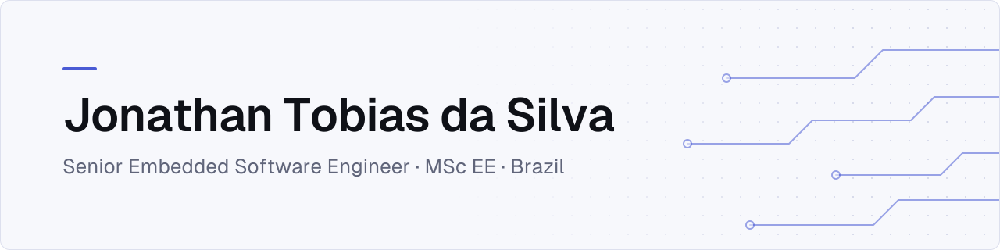

<!-- markdownlint-disable MD033 -->
<a href="https://www.jontobias.com">
  <picture>
    <source media="(prefers-color-scheme: dark)" srcset="assets/banner-dark.svg">
    
  </picture>
</a>
<!-- markdownlint-enable MD033 -->

## How I build

 

Handbook: [Naming](https://github.com/JonathanTSilva/.github/blob/main/handbook/naming.md) · [Branches and commits](https://github.com/JonathanTSilva/.github/blob/main/handbook/branches-and-commits.md) · [Repo anatomy](https://github.com/JonathanTSilva/.github/blob/main/handbook/repo-anatomy.md) · [Security](https://github.com/JonathanTSilva/.github/blob/main/handbook/security.md) · [AI assistance](https://github.com/JonathanTSilva/.github/blob/main/handbook/ai.md)

## Featured projects

| Project | What it does | Status |
| :--- | :--- | :--- |
| [scriptize](https://github.com/JonathanTSilva/scriptize) | Standardize the scripting environment to improve the maintainability, readability and efficiency of your scripts |    |
| [qemulab](https://github.com/JonathanTSilva/qemulab) | A modern TUI for managing QEMU development environments |    |
| [uanalyser](https://github.com/JonathanTSilva/uanalyser) | Traffic analyser for intrusion detection in OPC UA networks |    |
| [jts-website](https://github.com/JonathanTSilva/jts-website) | Personal bilingual website built with Astro and deployed to GitHub Pages |    |
| [leetsheet](https://github.com/JonathanTSilva/leetsheet) | A TUI-based LeetCode cheatsheet for quick problem walkthroughs in your terminal |    |
| [research-pump-cavitation](https://github.com/JonathanTSilva/research-pump-cavitation) | Diagnostic system for hydraulic pump failures by means of electric current analysis and machine learning tools |  |

## Latest writing

<!-- writing:start -->
- [Welcome](https://www.jontobias.com/blog/2026-04-welcome.en) (Apr 20, 2026)
- [Markdown Cheatsheet — Website Writing Reference](https://www.jontobias.com/blog/2026-03-markdown-cheatsheet.en) (Mar 30, 2026)

More on the [blog](https://www.jontobias.com/blog/).
<!-- writing:end -->

## Now

<!-- now:start -->
Bridging the gap between modern software practices and mission-critical industrial systems. Updated Apr 10, 2026. Read the full [Now page](https://www.jontobias.com/now/).
<!-- now:end -->

## Contact

[Email](mailto:jonathantosilva@hotmail.com) · [LinkedIn](https://www.linkedin.com/in/JonathanTSilva/) · [ORCID](https://orcid.org/0000-0002-2511-259X) · [Website](https://www.jontobias.com)
